# KV-Cache Research Notes

This document is the living research log for experiments, findings, decisions,
and next steps. See the README for stable project setup and usage information.

## Current Focus

Experiment 001 is complete. Experiment 002 has an expanded arithmetic and
story-problem pilot, with CPU/FP32 and CUDA/FP16 results that were very similar.
Experiment 002's controlled-factor CUDA/FP16 run is complete, and Experiment
003's operation, generalization, and token-position probes have been run.
Experiment 004's K/V substitution run and Experiment 005's hidden-state
activation-patching run are complete on CUDA/FP16. They test different
interventions: changing cached attention entries versus changing layer
activations.

## First Deliverable

The first experiment is complete when it includes:

- A small open-model inference run with inspected K/V cache tensors.
- An explanation of each cache dimension using the observed tensor shapes.
- A prefill/decode diagram that shows cache creation, reuse, and growth.
- Measurements across prompt/context lengths and token-by-token decoding.
- A table or plot of K/V cache size versus context length.
- A configuration-derived expected cache size, checked against bytes counted
  from the actual K/V tensors.

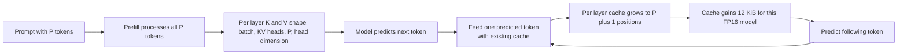

For the latest prompt run, P was 10: each layer's K and V tensors had shape
`[1, 2, 10, 64]` after prefill, then the cache grew one position per decode
step. The 12 KiB increment is measured for this model and dtype.

## Experiment Log

### 001 — KV-cache baseline (complete)

- Status: complete
- Script: `inspect_cache.py`
- Question: What K/V cache structure does the initial model produce after
  prefill?
- Observation: The model exposes a cache for 24 layers. For the documented
  five-token prompt, each layer's K and V tensors have shape `[1, 2, 5, 64]`
  in FP16.
- Measurement: Each K tensor occupies 1,280 bytes and each V tensor occupies
  1,280 bytes. Their combined per-layer storage is 2,560 bytes; across 24
  layers, the K/V tensors occupy 61,440 bytes (60 KiB).
- Decode measurement: Five generated tokens were fed one at a time. The cache
  grew from 5 prompt tokens / 61,440 bytes to 10 cached tokens / 122,880
  bytes. Each decode forward pass added one position per layer and 12,288
  bytes (12 KiB) overall. Intermediate measurements were 6 tokens / 73,728
  bytes, 7 / 86,016, 8 / 98,304, 9 / 110,592, and 10 / 122,880.
- Configuration check: The loaded configuration gives
  `24 layers × 2 (K and V) × 2 KV heads × 64 values/head × 2 bytes/FP16`
  = 12,288 bytes per token. The independent prefill sweep matched this at all
  tested lengths: 5, 10, 20, and 40 tokens, with zero-byte differences.
- Prompt variation: For `In the middle of May, the weather will be`, the
  tokenizer produced 10 tokens. After prefill, each layer's K and V tensors
  had shape `[1, 2, 10, 64]`; each K and V tensor used 2,560 bytes, for 5,120
  bytes per layer and 122,880 bytes (120 KiB) across all layers.
- Decode from the 10-token prompt: The five decode steps grew the cache to 11,
  12, 13, 14, and 15 tokens, using 135,168, 147,456, 159,744, 172,032, and
  184,320 bytes respectively. The cache again grew by 12,288 bytes per step.
  The generated text was `sunny and warm. The.`
- Interpretation: The cache layout is `[batch, KV heads, cached tokens,
  head dimension]`; each generated token should extend the cached-token
  dimension by one.
- Completed: prefill cache shape inspection, actual K/V tensor-byte
  calculation, and one-token-at-a-time decoding with linear cache growth.
- Sweep input note: the context sweep uses a separate fixed repeated passage,
  so changing the main `prompt` changes the standalone prefill/decode run but
  does not change the sweep data.
- Artifacts: [context sweep CSV](results/experiment_001_kv_cache/exp01_kv_cache_context.csv),
  [context sweep plot](results/experiment_001_kv_cache/exp01_kv_cache_context.png).

## Results Index

| Experiment | Question | Status | CSV | Plot | Key finding |
|---|---|---|---|---|---|
| 001 | How does cache structure and memory change with context length and decoding? | Complete | [CSV](results/experiment_001_kv_cache/exp01_kv_cache_context.csv) | [Plot](results/experiment_001_kv_cache/exp01_kv_cache_context.png) | Configuration estimate matches observed K/V bytes at 5, 10, 20, and 40 prefill tokens; decode growth is 12 KiB/token from both 5- and 10-token prompts. |
| 002 | Do equivalent arithmetic prompts have similar hidden states across layers and in larger problems? | Expanded pilot complete: CPU/FP32 and CUDA/FP16 | [CUDA/FP16 prompts](results/experiment_002_similarity/exp02_prompts_4.csv), [CUDA/FP16 pairwise data](results/experiment_002_similarity/exp02_pairwise_similarity_4.csv) | [CPU/FP32 layer plot](results/experiment_002_similarity/exp02_layer_similarity_3.png), [CPU/FP32 overlap plot](results/experiment_002_similarity/exp02_similarity_vs_lexical_overlap_3.png), [CPU/FP32 span plot](results/experiment_002_similarity/exp02_subproblem_span_similarity_3.png) | Hard negatives remained more similar than equivalent variants; matched CPU/GPU cosine scores differed by at most 0.00193. |

### Experiment 001 — KV-cache size by context

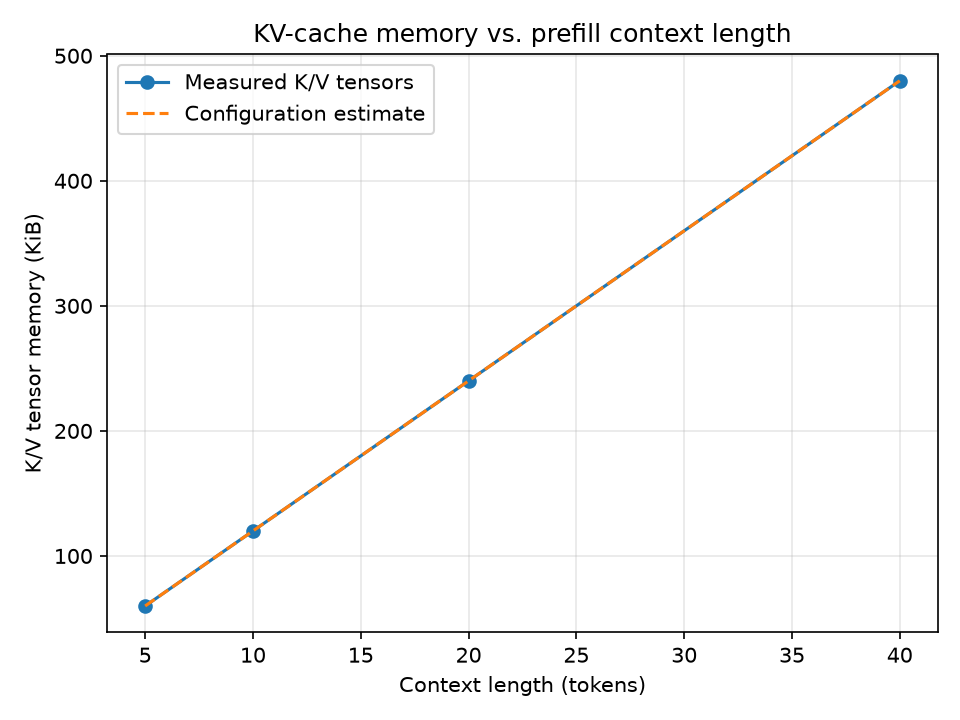

## Experiment 002 — Semantic Reuse Pilot

### Question

When prompts express the same computation in different words or framing, do
their internal representations become more similar across transformer layers
than representations for prompts that merely share words or structure?

### Initial Prompt Set

The reference computation is `17 × 23 = 391`.

- Equivalent: `Calculate 17 × 23.` (reference), `Compute 17 × 23.` (minor
  wording change), `What is the product of 17 and 23?` (paraphrase),
  `Multiply 23 by 17.` (reordered operands), and a boxes-and-widgets story
  encoding the same multiplication.
- Hard negatives: `Calculate 17 + 23.` shares both operands but changes the
  operation; `Calculate 17 × 24.` keeps the structure and operation but
  changes an operand.
- Unrelated controls: `What is the capital of Japan?` and `How many days are
  in a week?`
- Every model input appends the same `Answer:` suffix. The suffix gives the
  compared hidden states a common final token position; expected answers are
  labels for the prompt set, not provided to the model.

### Comparison Method

- Script: `experiment_002_semantic_reuse.py`
- Run the same Qwen model on each prompt independently with hidden-state
  output enabled and no token generation or KV-cache reuse.
- At every returned hidden-state layer, compare both the vector at the final
  `Answer:` position and the mean of all non-padding token vectors using cosine
  similarity. The CSV labels these representation methods separately.
- Compare each prompt against the same multiplication reference. Group pairs
  as equivalent, hard-negative, or unrelated, then plot mean similarity by
  group across layers.
- Compute token-ID Jaccard overlap on the prompt text before the shared suffix
  and plot it against final-layer cosine similarity. This makes lexical
  overlap visible alongside the semantic relation labels.
- Treat results as exploratory: the pilot has one arithmetic target and a
  small number of controls. It can reveal patterns to follow up, not establish
  a general semantic-reuse mechanism.

### Pilot Run 001 — CPU/FP32

- Script: `experiment_002_semantic_reuse.py`
- Execution: Qwen2.5-0.5B on CPU in FP32; this execution environment did not
  expose CUDA. Each prompt was run independently; no answer generation or
  cached-state reuse was performed.
- Inputs: 9 prompt bodies, each followed by the common `Answer:` suffix. The
  model-input lengths ranged from 9 to 22 tokens. The model returned 25
  hidden-state tensors: embedding output plus 24 transformer-layer outputs.
- Result at the final transformer layer: mean cosine was 0.930 across four
  equivalent pairs, 0.983 across two hard-negative pairs, and 0.759 across two
  unrelated pairs. The changed-operand negative (`17 × 24`) scored 0.996,
  higher than every equivalent pair except the simple wording variants.
- Lexical-overlap check: the two hard negatives had token Jaccard overlap
  0.778 with the reference; the product paraphrase had 0.333, the story
  framing 0.300, and unrelated questions 0.000. One unrelated prompt still
  scored 0.868 cosine, higher than the story framing at 0.838.
- The embedding-output comparison is 1.0 for every pair because every input
  ends with the same `Answer:` token. Interpret transformer layers 1–24 for
  contextualized comparisons.
- Preliminary reading: raw final-position cosine does not identify equivalent
  computation in this pilot; hard negatives can be more similar than valid
  paraphrases. The dataset is too small to generalize.
- The prompt set and complete layerwise pairwise measurements are linked in the
  results index above.

#### Final-layer pair results

| Prompt compared with multiplication reference | Relation | Token Jaccard | Cosine similarity |
|---|---|---:|---:|
| Compute 17 × 23 | Equivalent, minor wording | 0.778 | 0.973 |
| What is the product of 17 and 23? | Equivalent, paraphrase | 0.333 | 0.942 |
| Multiply 23 by 17 | Equivalent, reordered operands | 0.600 | 0.968 |
| Boxes and widgets story | Equivalent, story framing | 0.300 | 0.838 |
| Calculate 17 + 23 | Hard negative, different operation | 0.778 | 0.971 |
| Calculate 17 × 24 | Hard negative, changed operand | 0.778 | 0.996 |
| Capital of Japan | Unrelated | 0.000 | 0.649 |
| Days in a week | Unrelated | 0.000 | 0.868 |

#### Layerwise plots

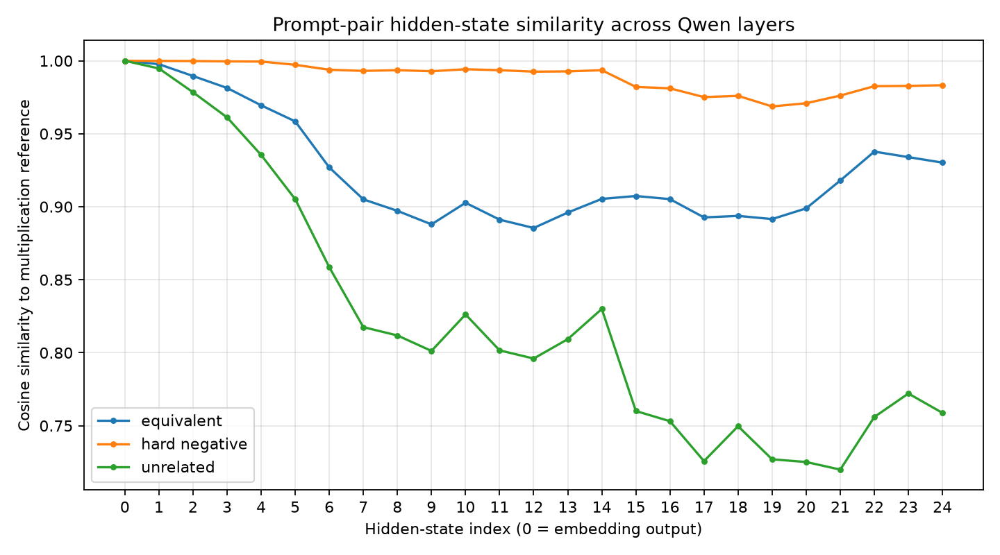

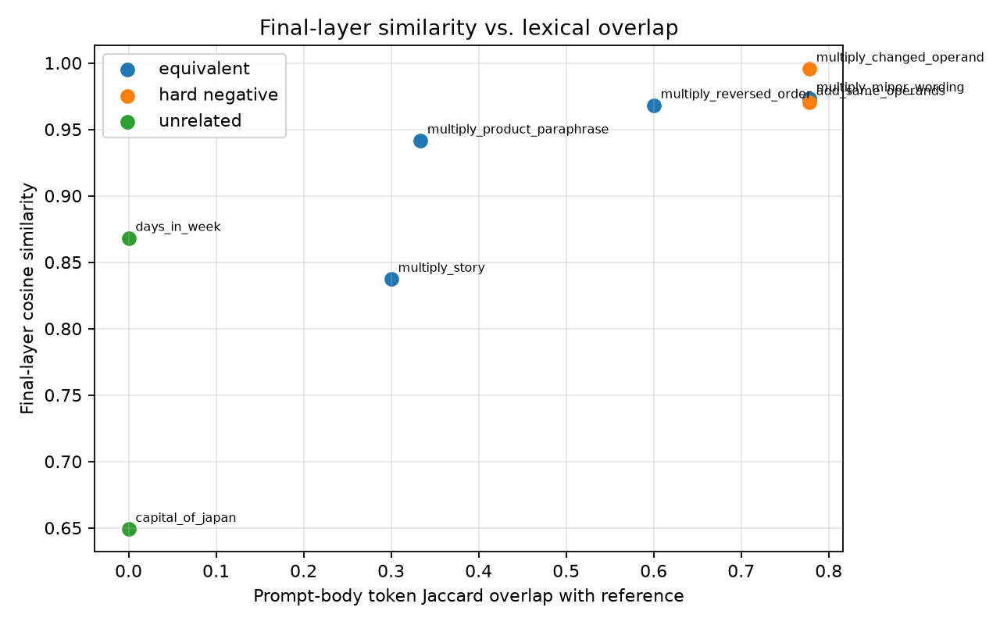

### Pilot Run 002 — Mean pooling comparison

- The same nine prompts and eight reference pairs were analyzed with both
  methods: the final shared `Answer:` position and the mean of all non-padding
  token vectors at each layer. This produces 400 pair/layer/method rows.
- Execution remained CPU/FP32. Final-layer mean cosine was 0.927 for the four
  equivalent pairs, 0.996 for the two hard negatives, and 0.783 for the two
  unrelated controls.
- The changed-operand hard negative (`17 × 24`) scored 1.000 after rounding.
  The story-framed equivalent scored 0.812. Mean pooling therefore did not
  make this pilot's cosine comparison distinguish equivalent computation
  from similar-looking hard negatives.
- In the layer plot, mean-pooled similarities for all groups approach 1.0
  through much of the middle network, then the unrelated group separates in
  the final layers. This high similarity across categories limits its value
  as a direct equivalence signal in this small example set.
- Artifacts: [pairwise comparison CSV](results/experiment_002_similarity/exp02_pairwise_similarity_2.csv),
  [layer comparison plot](results/experiment_002_similarity/exp02_layer_similarity_2.png), and
  [lexical-overlap plot](results/experiment_002_similarity/exp02_similarity_vs_lexical_overlap_2.png).

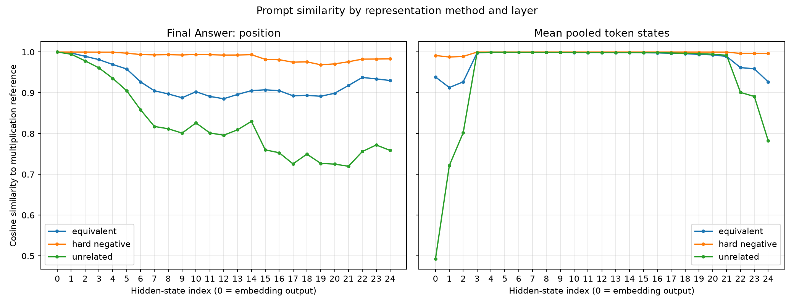

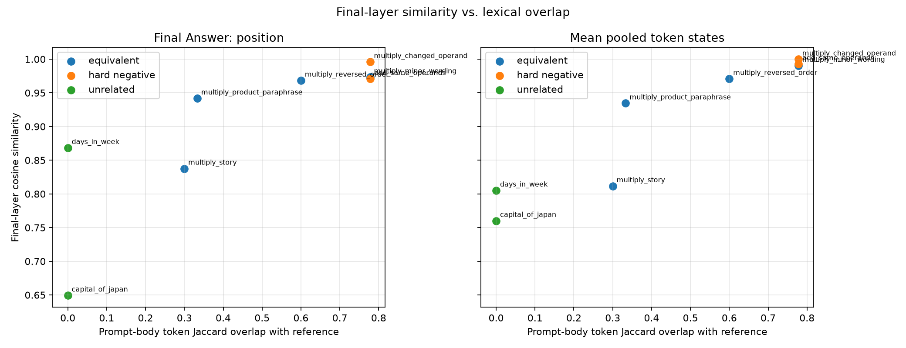

### Expanded Run 003 — Multiple targets and embedded subproblems

- Script: `experiment_002_expanded.py`. This run used Qwen2.5-0.5B on CPU in
  FP32; CUDA was intentionally deferred. No answers were generated and no KV
  cache was reused.
- The direct arithmetic set covers `17 × 23`, `12 + 19`, `46 − 18`, and
  `14 × 16`. For each target there are two equivalent wording variants, two
  hard negatives (changed operation or operand), and two unrelated controls:
  a balanced 2/2/2 comparison set. The two unrelated prompts are reused for
  each target.
- Three additional prompts frame `17 × 23` as a boxes-and-widgets story: one
  asks only for the product; two add or subtract 12 after that multiplication.
  The script compares both their full-prompt representations and the annotated
  multiplication phrase against the direct `17 × 23` reference span.
- The run evaluated 25 prompts, 30 pair definitions, and 1,425 pair/layer/
  representation rows across the embedding output and 24 transformer layers.
- At the final layer, arithmetic-only equivalent pairs averaged cosine 0.967
  for the final `Answer:` position and 0.959 for mean pooling. Hard negatives
  averaged 0.984 and 0.996, respectively. Unrelated controls averaged 0.749
  and 0.774. The hard negatives were more similar than the equivalent variants
  for each of the four targets under both representations.
- Full-prompt comparison to the direct multiplication prompt scored 0.838
  (final position) and 0.812 (mean pooling) for the simple story. The larger
  add-12 story scored 0.809 / 0.792, and the subtract-12 story scored 0.802 /
  0.802.
- The local `17 × 23` span compared with the story phrase had final-layer
  cosine 0.768. The three span curves overlap exactly: the phrase and its
  preceding text are identical in all story prompts. Because Qwen is causal,
  hidden states within that phrase cannot use the later add/subtract clause.
  This span metric therefore measures a local prefix representation, not a
  context-aware representation of the subproblem after reading the whole
  prompt.
- Preliminary reading: the four-target expansion reinforces the earlier
  result that these cosine methods do not distinguish equivalent arithmetic
  from hard negatives. The span experiment also exposes a causal-position
  limitation that must be addressed before interpreting localized computation.
- Artifacts: [expanded prompt set](results/experiment_002_similarity/exp02_prompts_3.csv),
  [pairwise measurements](results/experiment_002_similarity/exp02_pairwise_similarity_3.csv),
  [layer plot](results/experiment_002_similarity/exp02_layer_similarity_3.png),
  [lexical-overlap plot](results/experiment_002_similarity/exp02_similarity_vs_lexical_overlap_3.png),
  and [subproblem-span plot](results/experiment_002_similarity/exp02_subproblem_span_similarity_3.png).

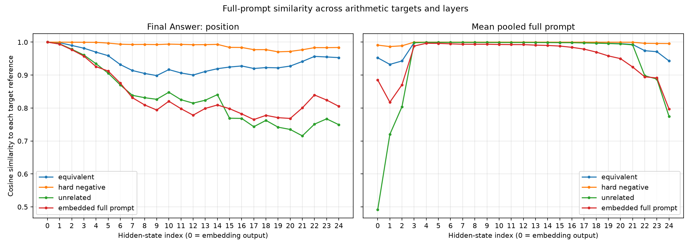

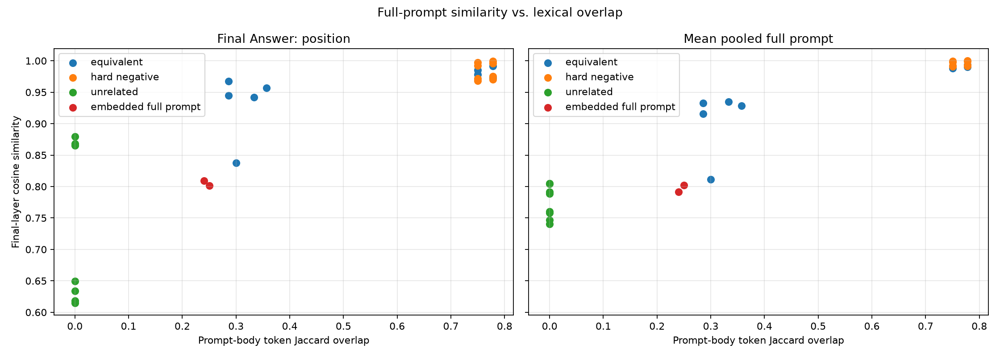

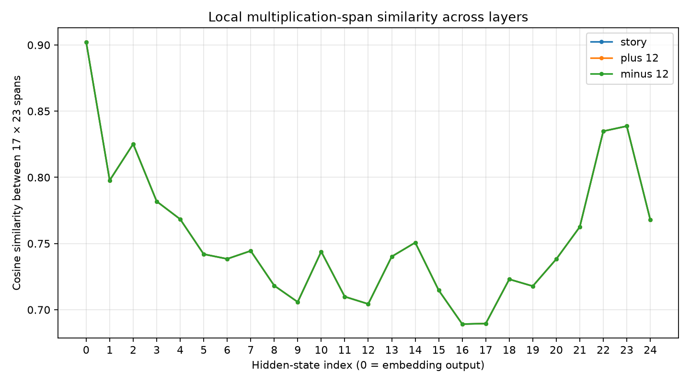

#### CUDA/FP16 Rerun

- The same 25 prompts and 30 pair definitions were run with Qwen2.5-0.5B on
  CUDA in FP16. No CUDA plots are embedded here; the CPU/FP32 figures above
  remain the visual reference.
- Final-layer arithmetic-only equivalent pairs averaged cosine 0.9529 for
  the final `Answer:` position and 0.9430 for mean pooling. Hard negatives
  averaged 0.9837 and 0.9957; unrelated controls averaged 0.7500 and 0.7746.
  These preserve the CPU/FP32 ordering and are within 0.001 of the CPU group
  means to the displayed precision.
- Across all 1,425 matched pair/layer/representation rows, the mean absolute
  CPU-versus-CUDA difference was 0.00018 and the maximum was 0.00193. The
  computation-span final-layer score was 0.7683 on CUDA/FP16 versus 0.7680 on
  CPU/FP32.
- Interpretation: for this prompt set and these cosine measurements, moving
  from CPU/FP32 to CUDA/FP16 did not materially change the observed pattern.
  This one-time check supports using CUDA/FP16 as the primary setting for later
  experiments; repeated device comparisons on this unchanged set are unlikely
  to add much.
- Data artifacts: [CUDA/FP16 prompt set](results/experiment_002_similarity/exp02_prompts_4.csv) and
  [CUDA/FP16 pairwise results](results/experiment_002_similarity/exp02_pairwise_similarity_4.csv).

### Next Actions

- [x] Define a controlled initial prompt set with equivalent, hard-negative,
      and unrelated examples.
- [x] Implement layerwise hidden-state capture, cosine comparisons, and a
      lexical-overlap control.
- [x] Implement CSV and plot output with unique filenames.
- [x] Run the pilot and inspect the prompt, pairwise similarity, and plot
      artifacts.
- [x] Record the preliminary similarity pattern and limitations.
- [x] Add mean pooling over non-padding token states for the same prompts and
      compare its layerwise cosine results with final-position pooling.
- [x] Expand to four arithmetic targets with balanced equivalent, hard
      negative, and unrelated comparisons.
- [x] Add story-framed and larger problems, comparing full prompts with a
      locally pooled computation span.
- [x] Run and review the expanded CPU/FP32 pilot; record its artifacts and
      limitations.
- [x] Repeat the expanded run in CUDA/FP16 and compare it with CPU/FP32.
- [x] Implement a controlled-factor arithmetic prompt set that independently
      varies operation, each operand, wording, and operator surface form.
- [x] Run the controlled-factor experiment on CUDA/FP16 and review its CSV and
      plots. The script intentionally has no CPU fallback.
- [x] Summarize the factor-wise layer patterns; next, test information
      recoverability with operation/operand probes.
- [ ] Improve subproblem-span analysis so the representation can reflect
      surrounding text that appears after the span in a causal model.

### Controlled-Factor Follow-up — CUDA/FP16 Complete

- Script: `experiment_002_factorial.py`. It requires CUDA and loads the
  existing Qwen2.5-0.5B checkpoint locally in FP16; if CUDA is unavailable, it
  exits before loading the model or writing results. The run completed on
  CUDA/FP16.
- The full factorial prompt grid crosses four operations (addition,
  subtraction, multiplication, division), two values for each operand
  (24/36 and 3/6), three wording templates ("Calculate", "Compute", "What
  is"), and two operator forms (symbol and word). This gives 96 prompts;
  division pairs have exact integer results.
- Matched comparisons change exactly one factor at a time: operation (144
  pairs), first operand (48), second operand (48), wording (96), or operator
  surface form (48), for 384 total pairs. Pair construction checks that only
  the intended factor differs.
- For each prompt, the script records the final shared `Answer:` position and
  the mean-pooled non-padding token representation at every hidden-state
  index. Pairwise cosine and prompt-body token Jaccard are recorded. Expected
  arithmetic answers are metadata only and are not supplied to the model.
- Final-layer mean cosine for final `Answer:` position pairs was 0.969 for
  operation changes, 0.972 for wording, 0.988 for symbol/word form, and
  0.995/0.996 for changing the first/second operand. Mean pooling was near 1
  for most factors through the middle layers, limiting its usefulness here.
- Interpretation: operation and wording changes affected final-position
  cosine more than operand changes in this prompt set, but cosine similarity
  alone does not show whether those properties are recoverable or support
  reusable computation. Follow up with operation/operand probes on held-out
  wordings and operand values.
- Artifacts: [prompt set](results/experiment_002_similarity/exp02_factorial_prompts.csv),
  [pairwise measurements](results/experiment_002_similarity/exp02_factorial_pairs.csv),
  [layerwise plot](results/experiment_002_similarity/exp02_factorial_similarity_by_factor.png), and
  [final-layer box plots](results/experiment_002_similarity/exp02_factorial_final_similarity.png).

## Experiment 003 — Operation Linear Probe

- Script: `experiment_003_probe.py`. It trains a multinomial linear probe on
  Qwen2.5-0.5B hidden states to classify addition, subtraction,
  multiplication, or division. The probe trains and evaluates on CUDA; the
  script exits if CUDA is unavailable and does not fall back to CPU.
- The deterministic split is made over ordered operand pairs before prompts
  are generated. It uses 304 training pairs and 76 held-out pairs from values
  2 through 21, with all four operations for each pair. Test pairs do not
  appear in training.
- Two evaluations are recorded at every hidden-state index: unseen operand
  pairs with the same symbolic prompt style, and unseen operand pairs using
  natural-language prompts after training on symbolic prompts. The probed
  vector is always the final shared `Answer:` token; chance accuracy is 25%.
- Same-style symbolic accuracy reached 100% from hidden-state index 1 onward
  (with a small dip to 99.7% at index 13). Cross-wording accuracy stayed near
  chance through index 14, peaked at 91.4% at index 16, and was 75.3% at
  indices 23 and 24. Transfer from symbolic to natural-language prompts is
  therefore layer-dependent in this prompt set.
- Interpretation: operation labels were linearly recoverable for unseen
  operand pairs in the symbolic format. Cross-wording recovery appeared in
  later layers but varied substantially by layer. This shows probe
  recoverability, not that the model uses the same signal to compute answers;
  only one symbolic and one natural-language template were tested.
- The script saves a CSV of layerwise accuracy, a CSV of prompt/split
  metadata, and an accuracy plot under unique names in `results/`. Operand
  recovery is a possible follow-up after reviewing operation-probe results.
- Artifacts: [layerwise accuracy](results/experiment_003_probes/exp03_operation_probe.csv),
  [prompt and split metadata](results/experiment_003_probes/exp03_probe_examples.csv), and
  [accuracy plot](results/experiment_003_probes/exp03_operation_probe_accuracy.png).

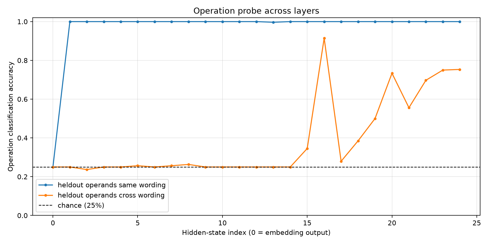

### Experiment 003 Follow-up — Generalization and Operand Probes (CUDA/FP16 Complete)

- Script: `experiment_003_generalization.py`. It extends the operation probe
  to three natural-language templates and trains separate linear probes for
  the operation, first operand, and second operand.
- Training uses symbolic prompts from 304 ordered operand pairs; testing uses
  76 disjoint ordered pairs in symbolic form and all three natural-language
  templates. Every score is recorded by layer at the final shared `Answer:`
  token. Chance is 25% for operation and 5% for each operand (20 candidate
  values).
- This tests whether operation information generalizes across both operands
  and phrasing, and whether operand values remain recoverable. Such
  generalization would be evidence that hidden states expose computation
  identity beyond a specific input pair, a prerequisite for investigating
  reusable computations; it would not itself demonstrate cache reuse.
- The script requires CUDA/FP16 and writes layerwise accuracies, prompt/split
  metadata, and plots to unique filenames under `results/`.
- On held-out pairs, symbolic operation accuracy reached 100% from layer 1.
  Natural-language operation transfer varied by template: noun-question
  accuracy peaked at 87.5% and ended at 76.3%; verb-question peaked at 89.5%
  and ended at 77.3%; verb-instruction reached and ended at 100% in later
  layers.
- Operand decoding was near-perfect on symbolic prompts. For natural prompts,
  final-layer accuracy varied: noun-question was 22.7% for operand A and
  15.8% for operand B; verb-instruction was 58.6% and 59.2%; verb-question
  was 46.1% and 27.6%. Operand chance accuracy is 5% (20 values).
- Interpretation: operation and operand information are recoverable beyond
  the training pairs, but transfer depends on wording and token position.
  This supports investigating computation identity; it does not show that
  Qwen uses these signals to compute or that cache reuse is possible.
- Artifacts: [layerwise results](results/experiment_003_probes/exp03_generalization.csv),
  [prompt and split metadata](results/experiment_003_probes/exp03_generalization_examples.csv), and
  [accuracy plot](results/experiment_003_probes/exp03_generalization_accuracy.png).

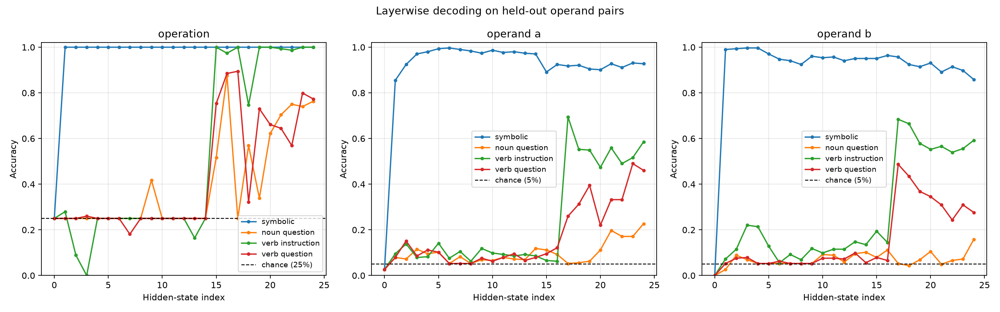

### Experiment 003 Extension — Token-Position Probe (CUDA/FP16 Complete)

- Script: `experiment_003_positions.py`. This extension is restricted to
  addition and multiplication. It trains layerwise operation probes on
  symbolic prompts and evaluates on disjoint operand pairs in symbolic and
  two natural-language styles.
- Each layer is probed at four role-aligned positions: the operation cue,
  operand A, operand B, and the final `Answer:` marker. For operation cues
  that span multiple tokenizer tokens, the selected vector is from the last
  overlapping token. The prompt/split CSV records selected token positions
  and token strings for review.
- This adds the token-position comparison missing from the earlier Experiment
  003 runs. The CUDA/FP16 run completed; the script has no CPU fallback.
- The goal is to test where addition-versus-multiplication information is
  readable and whether operation decoding transfers across operands and
  wording. Probe accuracy indicates recoverability, not that the model uses a
  particular token representation to calculate or reuse cached work.
- Symbolic operation-cue accuracy was 100% at every layer. Noun-question
  operation-cue accuracy reached 100% by layer 2, while verb-instruction
  operation-cue accuracy remained at chance (50%). At the final `Answer:`
  marker, symbolic accuracy was 100%, noun-question ended at chance, and
  verb-instruction reached 100% in later layers.
- Operand-position results varied: operand A was at chance for symbolic
  prompts and unstable for natural prompts; operand B was near-perfect for
  symbolic prompts and reached 90.1% (noun-question) and 88.8%
  (verb-instruction) at the final layer. A peak at one layer followed by a
  sharp drop should not be treated as stable decoding.
- Caveat: role-aligned positions are not identical token positions or token
  forms across styles (for example, `×` versus the first token "Multiply").
  This changes the input to the probe as well as its wording context, so
  cross-style differences do not isolate wording invariance by themselves.
- Artifacts: [layerwise results](results/experiment_003_probes/exp03_token_positions.csv),
  [prompt and selected-token metadata](results/experiment_003_probes/exp03_token_positions_examples.csv),
  and [position comparison plot](results/experiment_003_probes/exp03_token_positions_accuracy.png).

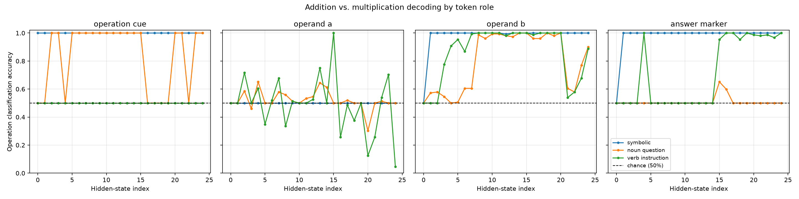

## Experiment 004 — Operator K/V Substitution (Implemented, Run Pending)

- Script: `experiment_004_kv_swap.py`. It tests addition and multiplication
  with a fixed symbolic template and single-digit operands, aligning the
  operator position between source and target prompts.
- For each target, it records an unmodified baseline, then substitutes K/V
  from source prompts using the same operation or the opposite operation. The
  source and target share the exact prefix through the operator; the
  same-operation source changes only a later operand, while the
  different-operation source changes only the operator. A self-copy control
  is also included. It tests each layer independently, six-layer bands, and
  all layers together across 24 target prompts.
- The target cache is built through its operator token. After replacing the
  selected K/V entries, the script recomputes every remaining target prompt
  token using the patched cache before greedy decoding. This ensures the
  intervention can affect later prompt representations and the answer. It
  does not measure prefill savings or establish whole-cache interchangeability.
- The CSV records source/target operations, patched layers, expected-answer
  token log-probability, longer greedy output, parsed answer, and arithmetic
  correctness. Answer parsing prefers explicit result markers and will not
  mistake an echoed operand for the answer. The revised run completed:
  baseline, self-copy, and same-operation transfer each preserved 23/24
  answers. Different-operation substitution reduced accuracy to 9/24 for
  layers 12–17 and 0/24 when all layers were patched. This shows an effect on
  answer behavior, but not consistent switching to the alternate operation.
- Artifacts: [CSV](results/experiment_004_kv_cache_swap/exp04_operator_kv_swap_2.csv) and
  [layerwise plot](results/experiment_004_kv_cache_swap/exp04_operator_kv_swap_accuracy.png).

## Experiment 005 — Hidden-State Activation Patching (CUDA/FP16 Complete)

- Script: `experiment_005_activation_patch.py`. It uses Qwen2.5-0.5B base on
  CUDA/FP16 and patches operator, final-prompt-token, or both activations at
  each layer. Donors are paired other-operation prompts, average other-
  operation activations, or average same-operation activations.
- The model answered all 120 held-out prompts correctly before intervention.
  Same-operation-average patches largely preserved answers. Paired and
  average other-operation donors produced similar patterns.
- Patching the operator activation disrupted original-answer accuracy in
  early layers, then the effect weakened: averaged across layers 0–7, accuracy
  was 4% for multiplication and 1% for addition; across layers 15–23, it was
  100% and 98%, respectively. Patching the final prompt activation had little
  effect through layer 14, then sharply reduced accuracy in later layers.
  Patching both produced strong early and later disruption, with partial
  recovery in between.
- Different-operation patches usually reduced support for the original
  answer but rarely made the alternate-operation answer correct. These
  interventions show influence on answer predictions, not clean operation
  switching or cache reuse.
- Artifacts: [layerwise results](results/experiment_005_activation_patching/exp05_activation_patch.csv) and
  [activation-patching plot](results/experiment_005_activation_patching/exp05_activation_patch_accuracy.png).

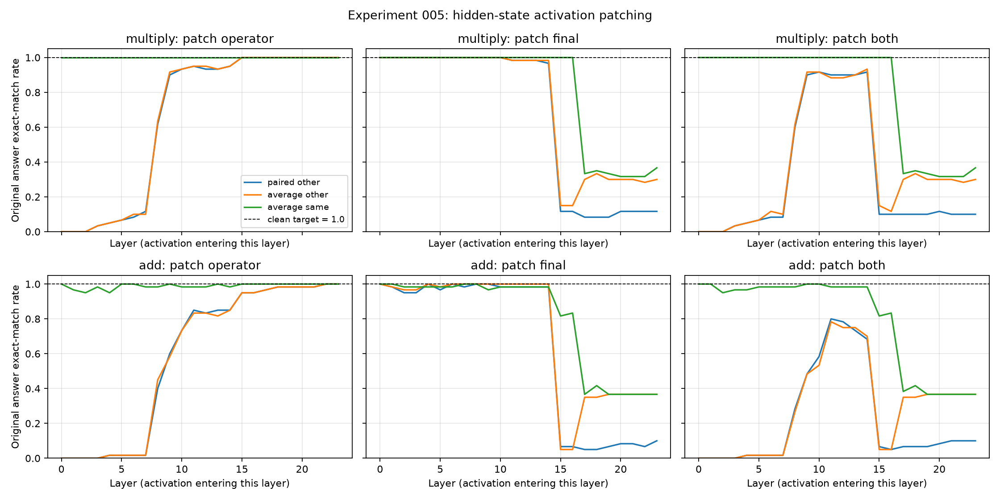

## To Do

- [x] Calculate K/V cache bytes from actual tensor `numel()` and
      `element_size()`.
- [x] Implement the expected bytes-per-token calculation from loaded model
      configuration and model dtype.
- [x] Run the calculation and verify expected bytes against actual K/V tensor
      bytes for 5, 10, 20, and 40 prompt tokens; every difference was zero.
- [x] Add one-token-at-a-time decoding using `past_key_values`.
- [x] Record cache sequence length and K/V tensor bytes after each of five
      decode forward passes.
- [x] Confirm that each decode forward pass adds one cached position per
      layer; observed growth was 12,288 bytes per token.
- [x] Implement a prefill sweep over 5, 10, 20, and 40 token prefixes and
      comparison with the configuration-derived estimate.
- [x] Implement CSV and measured-versus-expected plot output under unique
      filenames in `results/`.
- [x] Run the sweep, review its CSV and plot, and add their paths and findings
      to the results index.
- [x] Finalize the prefill/decode diagram with observed shapes, measured
      per-token growth, expected-versus-observed comparison, and artifact links.

## Decisions and Assumptions

- Report K/V tensor storage separately from total CUDA memory if both are
  discussed; total CUDA allocator measurements are not a substitute for
  counting the K/V tensors themselves.
- Distinguish prompt prefill from token-by-token autoregressive decoding in
  every experiment.
- Use `torch.inference_mode()` for inference measurements.
- Use fixed prompts and explicitly recorded parameters for reproducibility.

## Open Questions

- How closely does allocated CUDA memory track the bytes occupied by K/V
  tensors?
- How does memory growth vary across prefill and decoding?
- Can semantic similarity reveal cache redundancy worth exploiting?
